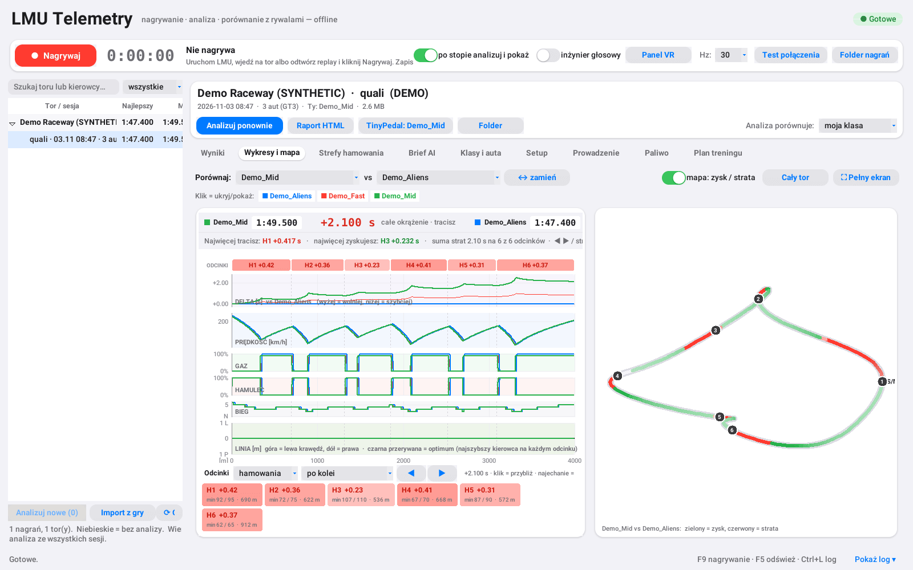
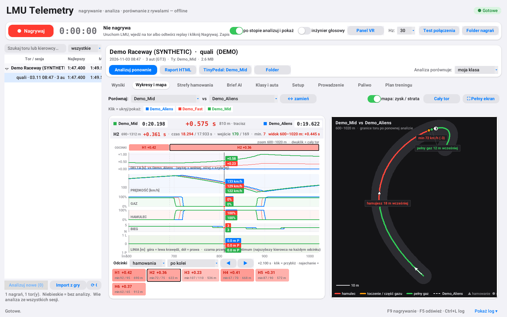
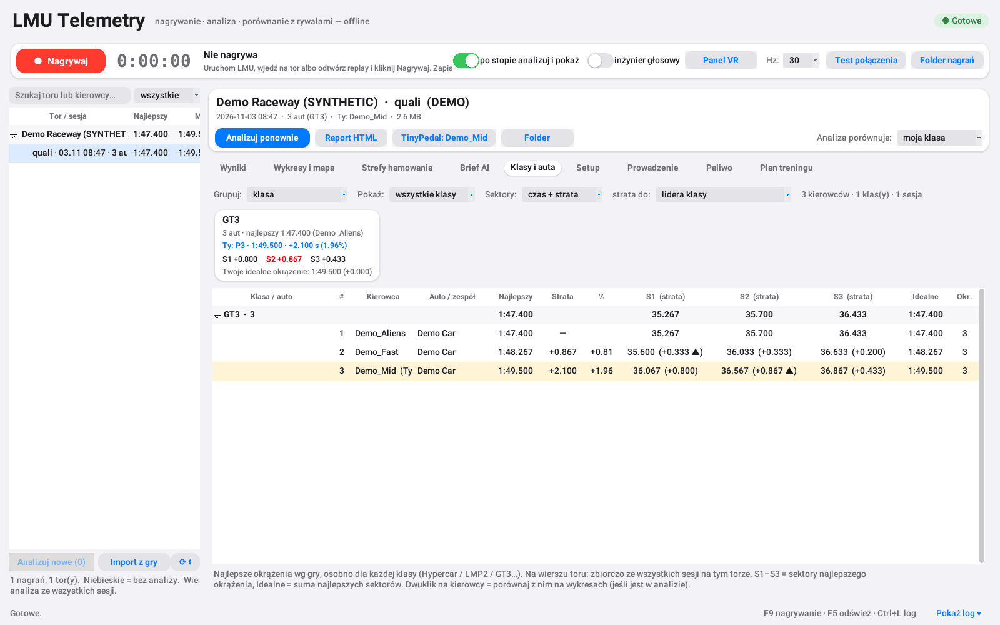
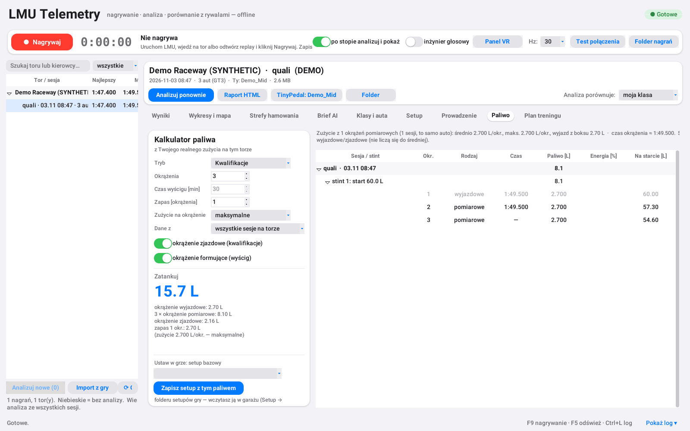
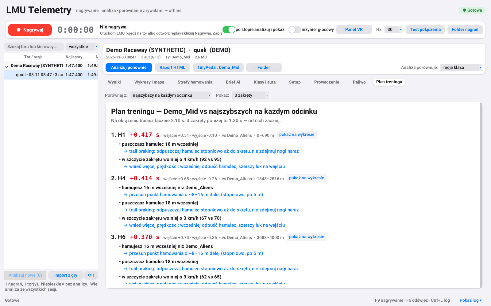
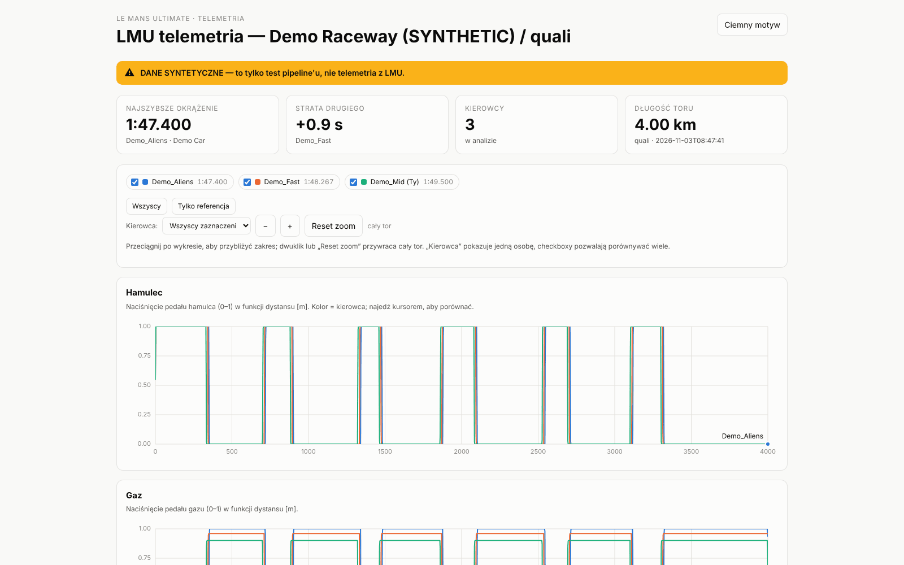

# LMU LoadTelemetry

**English** · [Polski](README.pl.md)

[](https://buymeacoffee.com/soa1marekd)

A local, offline telemetry tool for **Le Mans Ultimate**. It records **every car on track**
(throttle, brake, steering, gear, speed, position) from the game's official shared memory
and compares your laps with your rivals': where they brake, where they get back on the
throttle, which line they take and where you lose time. It also covers setups, fuel,
handling, a training plan and a voice race engineer for VR.

- Pure Python standard library + tkinter: no server, no account, no internet needed.
- Everything happens in one window. The HTML report is optional.
- The app UI is in **Polish**, so tab names below are given in Polish with an English gloss.

> Screenshots below show the app running on the **synthetic demo session**
> (`records_demo/`, generated by `make_demo.py`). This is not real player data.

| | |
|---|---|
| [](docs/screenshots/charts-map.png)<br>**Wykresy i mapa** (charts and map): time delta, speed, throttle, brake, gear and line per distance; per-segment gain/loss tiles; track map coloured by gain/loss | [](docs/screenshots/line-comparison.png)<br>**Corner zoom**: the map switches to a dark line-comparison view (brake / coast / full throttle, rival dashed) with braking point, apex and throttle markers |
| [](docs/screenshots/classes-cars.png)<br>**Klasy i auta** (classes and cars): best laps per class, gap to class leader, sectors, ideal lap | [](docs/screenshots/fuel-calculator.png)<br>**Paliwo** (fuel): per-lap consumption from your recordings and a fuel calculator for qualifying and races |
| [](docs/screenshots/training-plan.png)<br>**Plan treningu** (training plan): the corners where you lose the most, why, and what to try | [](docs/screenshots/html-report.png)<br>**HTML report**: interactive, self-contained report with zoom, tooltips and light/dark mode |

If the tool helps you go faster, you can [buy me a coffee ☕](https://buymeacoffee.com/soa1marekd).

## 0. Offline app (the easy way)

Double-click **`START_LMU_TELEMETRY.cmd`** (or run `pythonw lmu_app.py`).
The app is fully local and needs no internet connection.

Everything lives in **one window**, and you browse results inside the app (no browser needed):

- **Recording bar (top)**: `● Nagrywaj` / `■ Stop` (record / stop, or **F9**), a timer and live
  status (track, session, number of cars, best time, file size). With
  „po stopie analizuj i pokaż” (analyse and show after stop) enabled, the recording is
  analysed right away and opens on the right.
  **Test połączenia** (connection test) runs a 10-second LMU diagnostic (result in the log).
- **Library (left)**: tracks and their sessions (best time, your time and position).
  Blue rows are not analysed yet (double-click / Enter analyses them). A **track row** is
  the analysis across all sessions on that track. You can search by track or driver and
  filter by session type. „Analizuj nowe” (analyse new) processes everything at once.
  Right-click opens a menu.
- **Viewer (right)**:
  - **Wyniki** (results): ranking, gap, average Δ braking / throttle; ☐/☑ selects which
    drivers appear in the charts,
  - **Wykresy i mapa** (charts and map): **time delta** („Porównaj X vs Y”, compare X vs Y:
    where you gain or lose). A fixed bar at the top shows both drivers' times at the cursor
    (click on a chart pins the cursor, click the pin to release it) plus segment details:
    time, entry / minimum / exit speed, and how many metres earlier or later you brake and
    reach full throttle,
  - **Odcinki** (segments): a strip above the charts plus tiles such as `H1 +0.08` (colour =
    size of the loss/gain, click = zoom, hover = show the spot). Segment modes: from
    braking point, corners (from mid-straight to mid-straight), every 200 / 100 / 50 m; sort
    by loss/gain; ◀ ▶ or the arrow keys jump to the next segment. Dragging any range shows its
    delta (custom segment). Speed / throttle / brake / gear by distance + a track map
    (green = gain, red = loss). **⛶ Pełny ekran** (full screen, F11, Esc to leave) shows just
    the charts and map. Drag or mouse wheel = zoom, right button = pan, double-click = whole
    track. The cursor shows values and car positions on the map; clicking the map zooms to
    that spot,
  - **Klasy i auta** (classes and cars): your and your rivals' best times separately for each
    class (Hypercar / LMP2 / GT3…), optionally grouped by car/team. On a track row the numbers
    are aggregated over all sessions. Gap to the class leader (s and %), sectors of the best
    lap, ideal lap (sum of best sectors), number of laps. Double-click = compare in the charts.
    Δ S1/S2/S3 = how much you lose in each sector (to the class leader, to the class's best
    sectors or „mnie (Ty)” (me): + = how much you lose to that driver; ▲ = biggest loss).
    Sector view: time + loss in one cell / loss only / times only. Sectors and car model are
    also taken from LMU result files (`UserData/Log/Results/*.xml`, matched by session start
    time), so this works for older recordings too.
    „Analiza porównuje: moja klasa” (analysis compares: my class, the default) makes the
    session and track analysis use rivals from your class only, so GT3 is not compared with
    Hypercars,
  - **Setup**: the recorder copies the setup you are driving (`UserData/player/TempModFile.svm`)
    into the recording (`*.setupN.svm`) at the start and on every change during the session;
    ★ = setup used on your best lap. The name is recognised by comparing with `Settings/<track>`
    („name + N changes” when modified). Compare with a setup from another session or a saved
    file (differences highlighted, „tylko różnice” = differences only). For old recordings:
    „Przypisz setup z pliku…” (assign setup from file). On a track row: your sessions +
    the setup from your best lap,
  - **Prowadzenie** (handling): from `*.chassis.csv.gz` (your car's chassis at 100 Hz: wheel
    loads, suspension deflection, ride height, tyre slip angles, temperatures, g-forces).
    For every corner (detected from track curvature), separately for entry / mid / exit:
    balance = front − rear tyre slip (+ understeer, − oversteer), front load, front LLTD
    (lateral load transfer distribution between axles), load on the outside wheels, minimum
    ride height, phase time + a setup hint. Cards: average balance, tyres (inner/middle/outer,
    pressure, camber), ride height (minimum, at top speed, rake, bottoming).
    „Porównaj z sesją” (compare with session) = same track with a different setup: Δ balance
    and Δ time in every corner. Averaged over the 3 fastest laps. New recordings only (old
    ones have no chassis data), your car only (rivals don't send it),
  - **Paliwo** (fuel): your car's consumption on every lap from recordings (out / timed / in
    laps, stints, an „ran out of fuel” warning) + a calculator: qualifying (out lap + N timed
    laps + in lap), timed race (laps from your pace + the lap on which time runs out) or a
    lap-count race, formation lap (measured from race lap 1), margin. By default it uses the
    maximum consumption from all sessions with this car on this track. When the session has a
    setup, it also shows how many L/lap the game assumes and how far off that is.
    „Zapisz setup z tym paliwem” (save setup with this fuel) writes a copy of the chosen setup
    with the fuel set (LMP2/LMP3: `FuelSetting`, litres = index + 5; Hypercar/GT3:
    `VirtualEnergySetting` in %) into `Settings/<track>`. In the game: Garage → Setup → Load,
  - **VR: voice engineer + VR panel**: while recording, the recorder emits a `[LAP]` event
    after each of your laps. The „inżynier głosowy” (voice engineer) switch reads out: lap
    time, gap to your best, how many laps your fuel/energy lasts and, in a timed race, how much
    is missing to the finish and how much to save per lap. Voice: Windows (System.Speech);
    Polish if installed (Settings → Time & language → Speech → Add voices → Polish), English
    otherwise. „Panel VR” = a black window with large values you can pin in your headset via
    OpenKneeboard („Window capture” tab → window „LMU Panel VR”),
  - **Corner line comparison**: when zoomed in, the map switches to a dark style: your line
    coloured brake / coast / full throttle, the rival as a white dashed line, markers
    ▲ braking, ● apex (minimum speed), ● full throttle with a description of the differences,
    and the cars at the cursor,
  - **Plan treningu** (training plan): the 3 (5 / all) segments where you lose the most, with
    loss on entry and exit, reasons in Polish and a tip: braking point and pressure, brake
    release (trail braking), coasting without throttle or brake, apex speed, full throttle,
    exit speed, line at the apex. Compare with a chosen driver or with the fastest driver in
    each segment; „pokaż na wykresie” (show on chart) zooms to the corner; also a list of
    places where you are faster,
  - **Import z gry** (import from game): LMU's built-in telemetry (Settings → Controls →
    Gameplay → Telemetry Recording) saves every session to `UserData/Telemetry/*.duckdb` (your
    car + setup). The „Import z gry (n)” button converts new files into app recordings
    (session „z gry” (from game), setup included, GPS position fitted to the map from an
    earlier recording of the track) and analyses them right away. This also works for sessions
    the app did not record. Files still being written (session in progress) are skipped, as
    are files without a full lap and sessions that an app recording covers for ≥90% of the
    time (no duplicates). When the app recorded for less time than the game, the game file is
    imported, because it has laps the app missed. Rivals: the game file only has your car, but
    „Klasy i auta” adds all drivers from the LMU results file (best time, sectors, car model);
    there are no charts/lines for them. Requires `python -m pip install duckdb`. File format
    and the setup key table: LMU Telemetry Lab (MIT),
  - **Driving line**: the „LINIA” (line) panel shows where each driver was between the track
    edges (top = left, bottom = right; edges from `mTrackEdge` of all cars in the recording).
    When a segment is zoomed, the map shows that part with tarmac and the cars' real lines.
    The black dashed line is the **optimum from the data** (on each segment, the line of the
    driver who was fastest there). The game's driving-assist line cannot be read: LMU track
    files (`.mas`) are encrypted. Older analyses need „Analizuj ponownie” (analyse again) to
    get the line and edges,
  - **Strefy hamowania** (braking zones): H1…Hn for the selected drivers (double-click = zoom
    to the corner),
  - **Brief AI**: a ready-made text to copy into Claude/ChatGPT.
- **Raport HTML** (HTML report) opens the full report in the browser; **TinyPedal** exports
  the lap of the selected driver (or yours).

Settings (driver, rival filter, options) are saved in `lmu_app_settings.json`.
Session reports go to `analysis/<file name>/`, the track report to `analysis/track_<track>/`.

### Track filter

- **szybsi lub szybszy sektor** (faster or faster sector, default): a driver is included if
  their lap is better than your chosen lap **or** any sector is faster by more than the
  tolerance (default 0.15 s).
- **tylko szybsi** (faster only): only a better lap.
- **wszyscy** (everyone): no filter.

The track report also adds **your best lap from every other session** (up to 3, lines such as
„Ty · Q 31.10 21:32”; T = practice, Q = qualifying, W = race), including sessions imported
from the game, so the charts and map show what you changed between sessions. Laps shorter than
the driver's record according to the game (aborted run, distance carried over from the
previous lap right after the line) are discarded.

Sectors for older recordings are computed from telemetry (0/1/2) with ~0.2 s accuracy (5 Hz).
New recordings also store sectors from LMU scoring.

In the HTML report:

- driver selection („Kierowca” list) and checkboxes to compare several drivers,
- **zoom**: drag over a chart, `+`/`−`, double-click or **Reset zoom**,
- track map with `H1…Hn` markers, checkbox **Pokaż linie zaznaczonych kierowców** (show lines
  of selected drivers),
- tooltips, light/dark mode, tables and CSV export.

---

Reads telemetry of **all cars** from Le Mans Ultimate: throttle, brake, steering, gear, RPM,
speed, X/Z position, lap and distance. The goal is to compare the fastest drivers in
qualifying: when they brake, when they get back on the throttle and where on track they do it.

> **Status:** verified on live LMU (online): shared memory works, all cars are visible
> (9–40), and **rivals with `ctrl=2` have real, changing throttle/brake values**.
> Practice, qualifying and a race at Paul Ricard were recorded and analysed.
> The offline app, HTML reports and AI brief work. Replay playback (`ctrl=3`) is still to be
> checked; it has not been tested.

---

## 1. What works and what still needs confirming

**Works / verified**

- Reading LMU's official shared memory `LMU_Data` (no third-party plugins).
- The `SharedMemoryTelemetryData.telemInfo[104]` array contains telemetry for **all active
  vehicles**, not just the player.
- On a real dump from Barcelona (session with 44 cars) every vehicle had its own `throttle`,
  `brake`, `steering`, `gear`, `rpm`, position and distance.
- The logger writes all cars to `csv.gz`; analysis and the HTML report work.
- **Live online**: 9–40 cars; rivals with `ctrl=2` have real, changing throttle/brake
  (confirmed with the probe and with qualifying/race recordings at Paul Ricard).
- Demo without the game: `make_demo.py` + `analyze.py` (synthetic data, marked in the report).
- The offline app (`lmu_app.py`) and per-track analysis (`track_analysis.py`) work.

**To be confirmed**

- Whether the array contains all cars during **replay playback** (`mControl == 3`).
  LMU's replay HUD shows every car's inputs, so it is very likely, but I have not tested it
  live.
- Rival accuracy: shared memory refreshes their data at ~5 Hz (0.2 s, ~10–15 m at high
  speed). Treat deltas smaller than ~10–15 m as approximate.
- If online/replay only exposes the spectated car, you have to record one car at a time by
  switching the camera (see section 5).

**Rejected approach**

- A direct offline `.Vcr` parser: the format is binary, undocumented and different from the
  classic rF2 VCR (gMotor/network log). I found no ready-made parser for LMU.
  The reliable route is **replay in the game + `record.py`**.

---

## 2. Requirements

- Windows + Python 3.11+ (the plain standard library is enough: **no `pip install`**).
- LMU installed and started **without** the `lmu-spoof` dummy running.
- In LMU: `Settings → Gameplay → Enable external plugins` = on
  (your `Settings.JSON` already has `true`).

> **Note about the dummy:** `C:\soa1\local\lmu-spoof\fake\Le Mans Ultimate.exe` holds the
> process name, port 6397 and `LMU_Data`. Close the spoof/GUI before starting the real LMU,
> otherwise the game will not start or there will be a memory/port conflict.

---

## 3. Quick start: live qualifying

```powershell
cd C:\soa1\local\LMU-LoadTelemetry

# 1. diagnostics: are all cars visible and do their inputs change?
python record.py --probe-seconds 10

# 2. record the whole session (Ctrl+C stops)
python record.py --out records --hz 30

# 3. after the session: analysis
python analyze.py records/*.csv.gz --out analysis --top 6

# 4. open the report
start analysis\report.html
```

In `--probe-seconds` mode you will see a table (column headers are in Polish:
kierowca = driver, gaz = throttle, ham = brake, okr = laps):

```
id   ctrl  kierowca          gaz min/max   ham min/max   okr   best
 5      2  Jan Kowalski      0.00/1.00     0.00/0.97      12   1:34.512
```

- `ctrl`: 0 = player, 1 = AI, 2 = remote (online), 3 = replay.
- The `gaz min/max` / `ham min/max` columns show whether the values change.
  If everyone except one car has `0.00/0.00`, the array only contains the spectated car in
  this session; see section 5.

---

## 4. Replay (without driving): the most accurate way

`.Vcr` files cannot be read directly (binary, undocumented format), so the replay is
**played back in the game while the app records it** like a live session:

1. In the app set **Hz: 100** (recording bar).
2. In LMU: **Replay** → choose the session (e.g. qualifying).
3. Rewind to the **start** of the session, click **● Nagrywaj** (record, F9) and play the
   replay at **1×**.
4. **Do not seek during playback** (rewinding mixes up laps) and do not use fast-forward.
   It is enough to play through the fastest lap of the drivers you are interested in.
5. **Stop**: with „po stopie analizuj i pokaż” enabled, the result appears on the right
   immediately.

The **Dane** (data) column in **Wyniki** shows how many samples/s each driver's lap actually
has, so you can check whether the replay gives rivals more accurately than online (~5 Hz).
Whether LMU refreshes all cars faster than 5 Hz during a replay has not been checked yet.

> Until 31.10.2026 the recorder only stored a frame when the scoring time changed (~5 Hz),
> so even your own car had 5 samples/s. It now stores every new telemetry frame (your own car
> up to 100 Hz). Older recordings have 5 Hz for everyone.

## 5. When rivals' inputs are zero

What to do, in order:

1. Run `--probe-seconds` in an online session: does `ctrl=2` have changing throttle/brake?
2. If not, use the **replay** of qualifying (the game plays back all cars locally there).
3. If the replay also only shows the spectated car:
   - record one driver at a time by switching the camera (the middle mouse button in the
     replay shows the input HUD),
   - or use the built-in replay HUD to read values manually (no export).
4. LMU's built-in telemetry (`.duckdb` in `UserData/Telemetry`): according to tools that read
   these files, the metadata holds a single `DriverName`, so it most likely only contains
   your own car; it is not suitable for rivals.

---

## 6. What the analysis produces

After `python analyze.py records/file.csv.gz --out analysis`:

| File | Contents |
|---|---|
| `analysis/report.html` | interactive report: brake/throttle/speed, track map, braking zones, tables |
| `analysis/best_laps.csv` | each driver's best lap, gap, coverage |
| `analysis/braking.csv` | braking zones: start, end, throttle pickup, Vmin, max brake, deltas |
| `analysis/traces.csv` | traces resampled every `--grid` metres (Excel / MoTeC / your own scripts) |
| `analysis/summary.json` | machine-readable summary (drivers, zones, deltas) |

The report:

- **Brake / Throttle / Speed**: traces by distance; colour = driver.
- **Track map**: the reference line coloured by braking force, `H1…Hn` markers.
- **Braking zones**: a table of where each driver brakes and how many metres earlier/later
  than the reference. Negative braking `Δ` = brakes **earlier** (shorter distance), positive =
  later; negative throttle `Δ` = gets on the throttle earlier. With rival data at ~5 Hz
  (0.2 s), treat deltas smaller than ~10–15 m as approximate.
- **Best laps**: times and average deltas.
- **Data table**: values every 100 m (a tabular view of the charts).
- Light/dark mode, tooltips, a legend with driver filtering.

Lap time: if `mBestLapTime` is present in the data, the analysis uses the exact time from the
game; otherwise the `lap_start_et` difference (accurate to one sample).
If `lap_start_et` is zero (common for remote cars), the analysis detects laps from
`mLapNumber` and the `lap_dist` wrap-around.

---

## 7. Files in the project

| File | Role |
|---|---|
| `lmu_shm.py` | LMU structure mapping + `LMU_Data` reader (offline dump and live) |
| `record.py` | logs all cars to `records/*.csv.gz`; `--probe-seconds` mode |
| `analyze.py` | lap detection, braking zones, deltas, CSV + HTML |
| `report_template.html` | report template (no external libraries/CDN) |
| `make_demo.py` | synthetic session for testing without the game |
| `lmu_app.py` | desktop app (recording, session library, results viewer, AI brief) |
| `lmu_theme.py` | iOS-style look (rounded cards, capsule buttons, switches) |
| `lmu_gamerec.py` | import of LMU built-in telemetry recordings (DuckDB) with setup |
| `lmu_coach.py` | training plan: diagnosis of corner losses and tips |
| `lmu_engineer.py` | live race engineer: per-lap messages, Windows voice (VR) |
| `lmu_fuel.py` | fuel / energy use per lap, stints, fuel calculator |
| `lmu_handling.py` | handling analysis: corners from curvature, balance from tyre slip, load transfer, tyres, ride height |
| `lmu_setup.py` | LMU setups: finding the game folder, `.svm` parser, name recognition, comparison |
| `lmu_results.py` | LMU result files (XML): laps and sectors of all drivers, car model |
| `lmu_classes.py` | best times per class / car from recordings (cached in `analysis/_best`) |
| `lmu_view.py` | charts and track map in the app (tkinter Canvas) |
| `ai_coach.py` | AI brief generator (`ai_brief.md`) |
| `track_analysis.py` | per-track analysis: 3 best laps + faster/sector filter |
| `to_tinypedal.py` | export of best laps to TinyPedal (`.tplap`) |
| `START_LMU_TELEMETRY.cmd` | double-click to start the app |
| `records_demo/`, `analysis_demo/` | example/demo (**synthetic** data) |
| `docs/` | screenshots and the GitHub Pages landing page |

---

## 8. Technical details (for future LMU updates)

LMU has its own shared memory interface, described in:

```
<LMU>/Support/SharedMemoryInterface/SharedMemoryInterface.hpp
<LMU>/Support/SharedMemoryInterface/InternalsPlugin.hpp
```

The key structure:

```cpp
struct SharedMemoryTelemetryData {
    uint8_t activeVehicles;
    uint8_t playerVehicleIdx;
    bool playerHasVehicle;
    TelemInfoV01 telemInfo[104];   // all active cars
};
```

Verified empirically for **LMU 1.4200** (dump with 44 cars):

- `SharedMemoryObjectOut` = 324,820 B (the game's mapping is 327,680 B).
- `ScoringInfoV01` = 552 B; `vehScoringInfo` starts at `scoring + 560`, stride 584 B.
- `telemInfo` starts at `telemetry + 4`, stride 1888 B.
- `mID` in `TelemInfoV01` and `VehicleScoringInfoV01` is 4 B (despite `long` in the header).
- Input fields: `mUnfilteredThrottle`, `mUnfilteredBrake`, `mUnfilteredSteering`,
  `mGear`, `mEngineRPM`, `mLocalVel`, `mPos`, `mLapNumber`, `mLapStartET`,
  `mElapsedTime`; scoring: `mLapDist`, `mPathLateral`, `mTrackEdge`, `mBestLapTime`,
  `mLastLapTime`, `mDriverName`, `mControl`.
- Events `LMU_Data_HoldEvent` / `LMU_Data_DataEvent`; the reader waits for a new frame and
  reads twice (consistency check), because `Interlocked*` are intrinsics and are not exported
  from `kernel32` on Win64.
- `Plugin Mask` = 4 in `Settings.JSON` (100 Hz by default). The logger samples at 30 Hz by
  default and skips repeated frames while paused.

If an LMU update changes the structure layout, verify the offsets on a fresh `LMU_Data` dump
(e.g. `python lmu_shm.py file.bin`).

---

## 9. Troubleshooting

| Symptom | Cause / fix |
|---|---|
| `Nie moge otworzyc 'LMU_Data'` (cannot open) | LMU is not running or `Enable external plugins` is off |
| `active=0` | menu/monitor/garage: get on track or play a replay |
| All throttle/brake = 0 | session is in the menu; or this version only exposes the spectated car (section 5) |
| The game does not start | `lmu-spoof` is running (fake process, port 6397, `LMU_Data`): close it |
| `EAC Failed to get anti cheat handle` in `trace.txt` | an EAC warning; the last session still ended cleanly |
| Files too large | `--hz 20`, `--driver "name"`, shorter sessions |
| No braking zones | data too smooth/sparse; try `--grid 1` and a longer recording |
| Garbled names (`S�bastien`) | the CSV is UTF-8; open it in an editor/Excel as UTF-8, not CP1252 |

---

## 10. AI analysis

`python ai_coach.py analysis/<session> --driver "Marek"` (or `analysis/track_<track>`) creates
`ai_brief.md`: lap time tables, braking zones, deltas and a ready-made prompt for an AI.

- The AI gets **computed numbers**, not 2 million raw samples, so its conclusions are based on
  data instead of guesses.
- The prompt asks for specific corners/distances and for separating certain conclusions from
  uncertain ones (rival data is ~5 Hz).
- The app has a **Brief AI** tab with copy to clipboard.
- Optionally sending it to the Claude API could be added if you have `ANTHROPIC_API_KEY`;
  by default everything stays local.

## 10a. Export to TinyPedal (reference for the delta and widget)

`to_tinypedal.py` turns the best lap from a recording into a TinyPedal Best Lap file
(`.tplap`): track, class, time, driver, car, delta (time vs distance) and telemetry every 5 m
(throttle, brake, speed, steering, gear).

```
python to_tinypedal.py records/file.csv.gz                       # your best lap
python to_tinypedal.py records/file.csv.gz --driver "Bacon"      # a rival's lap
python to_tinypedal.py records/file.csv.gz --class LMP2_ELMS --top 3
```

Files go to `tinypedal_laps/`. In TinyPedal: **Tools → Best Lap Manager → Import**. The loaded
lap becomes the reference for the delta and for the **Best lap telemetry** widget
(throttle/brake/speed) for that track and class. Your own record is always kept
(`deltabest\personal_best`) and still updated when you improve it; **Restore Own** brings it
back. If you beat the loaded lap, yours automatically becomes the reference.

Notes:
- Rivals are sampled at ~5 Hz (every ~10–15 m), so braking points are approximate (linear
  interpolation); your own car depends on the recording `--hz`.
- The class must match the in-game one (`mVehicleClass`), otherwise TinyPedal will not match
  the lap to the track and class.
- Requires TinyPedal with the `feature/best-lap-telemetry` branch (Best Lap Manager).

## 11. Fair play / safety

- The tool **only reads** LMU's official shared memory. It does not inject code, modify the
  game or bypass EAC.
- Rival data is visible in the game's own replay/HUD; use it for analysis **after the
  session**, not as a live coach during a race, because online rules may forbid that.
- Don't publish other people's names/SteamIDs without a reason.

---

## 12. Demo without the game

```powershell
python make_demo.py --out records_demo
python analyze.py records_demo/*.csv.gz --out analysis_demo
start analysis_demo\report.html
```

The demo is **synthetic**: the report has a yellow „DANE SYNTETYCZNE” (synthetic data) banner.
It is there to check the charts, tables and delta without running LMU. To browse it in the
app, copy `records_demo/*` into `records/` and click „Analizuj” (analyse).

---

## Support

LMU LoadTelemetry is a free hobby project. If it saves you time or tenths of a second, you
can support it on **[Buy Me a Coffee](https://buymeacoffee.com/soa1marekd)**. Thank you!
